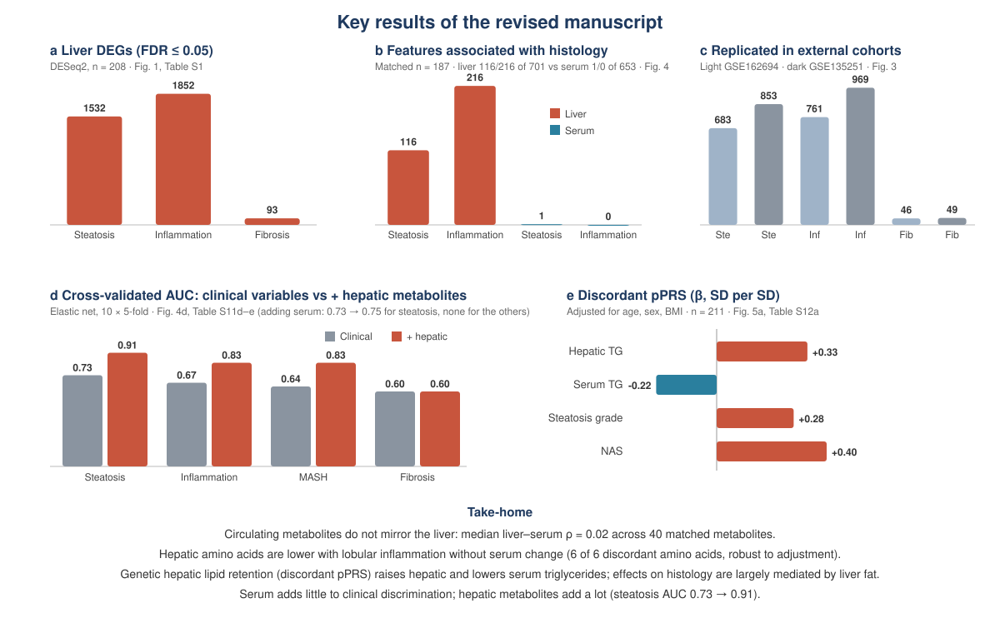
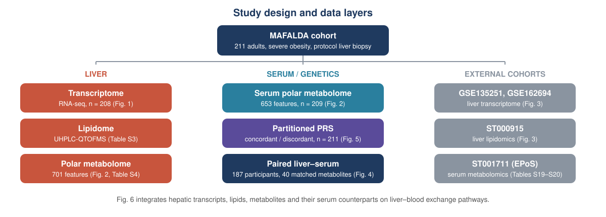
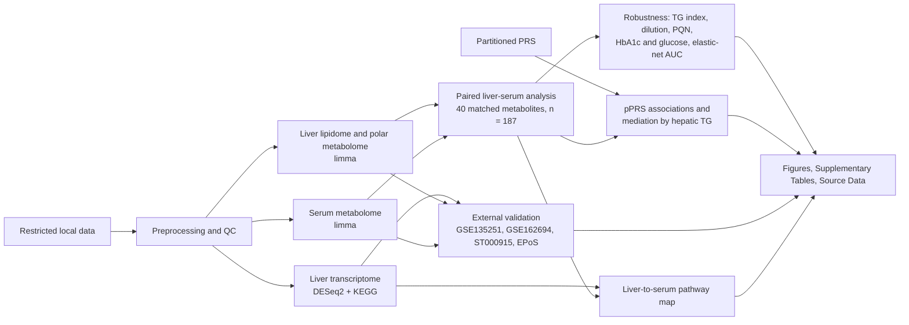

<p align="center">
  
</p>

<p align="center">
  <a href="https://www.r-project.org/"></a>
  <a href="LICENSE"></a>
  
  
  
</p>

<p align="center">
Code for <b>"Matched liver–serum multi-omics and genetic risk reveal hepatic compartmentalization of metabolic disease in severe obesity"</b> (Gupta et al.).<br/>
Liver transcriptome, lipidome and polar metabolome, serum metabolome and partitioned polygenic risk scores in 211 MAFALDA participants, with external validation in three public cohorts.
</p>

> **Scope.** This repository contains analysis code, Supplementary Tables and per-figure Source Data scripts. Individual-level clinical and omics data are **not** included (consent does not cover public release).

---

## Contents

[Main findings](#main-findings) · [Study design](#study-design) · [Workflow](#workflow) · [Repository structure](#repository-structure) · [Figure and table map](#figure-and-table-map) · [Running the code](#running-the-code) · [Source Data](#source-data) · [Statistical conventions](#statistical-conventions) · [Data availability](#data-availability) · [Citation](#citation)

---

## Main findings

<p align="center">
  
</p>

1. **Circulating metabolites do not mirror the liver.** In 187 participants with matched samples, 40 metabolites measured in both compartments correlated weakly (median Spearman ρ = 0.02).
2. **Histology is a hepatic signal.** Steatosis and lobular inflammation were associated with 116 and 216 of 701 hepatic metabolites but ≤ 1 of 653 serum metabolites.
3. **Hepatic amino acids are lower with lobular inflammation without serum change**, independently of tissue fat, sample dilution and glycemia, although largely shared with steatosis.
4. **Serum adds little to clinical discrimination** (steatosis AUC 0.73 → 0.75; nothing for inflammation, MASH or fibrosis), whereas hepatic metabolites raise it to 0.91 for steatosis.
5. **A discordant partitioned PRS** (genetic hepatic lipid retention) is associated with higher hepatic but lower serum triglycerides; its effects on inflammation and MASH are largely mediated by liver fat.
6. **Transcriptomic and hepatic triglyceride signatures replicate externally** (GSE135251, GSE162694, ST000915); the phosphatidylcholine signature does not.

---

## Study design

<p align="center">
  
</p>

| Layer | Source | Participants | Used in |
|---|---|---:|---|
| Hepatic transcriptome (RNA-seq) | liver biopsy | 208 | Fig. 1, Fig. 3, Fig. 6 |
| Hepatic lipidome | liver biopsy | – | Table S3, Fig. 3 |
| Hepatic polar metabolome | liver biopsy | – | Fig. 2, Table S4, Fig. 4 |
| Serum polar metabolome | serum | 209 | Fig. 2, Table S10a |
| Matched liver–serum polar metabolome | liver + serum | 187 | Fig. 4, Tables S10b–S11 |
| Partitioned polygenic risk scores | genotype | 211 | Fig. 5, Table S12 |

---

## Workflow



---

## Repository structure

```text
masld-sex-stratified-multiomics/
├── README.md
├── LICENSE
├── analysis/
│   └── MASLD_main_manuscript_analysis.Rmd   # full workflow, manuscript order, run top to bottom
├── figures/                                  # one folder per figure / table group
│   ├── Table1_cohort/
│   ├── Fig1_hepatic_transcriptome/           #   <folder>.Rmd, tables/ (CSV), source_data/
│   ├── Hepatic_lipidome/
│   ├── Hepatic_polar_metabolome/
│   ├── Fig2_serum_metabolome/
│   ├── Fig3_external_validation/
│   ├── Fig4_paired_liver_serum/
│   ├── Fig5_pPRS/
│   ├── Fig6_pathway_map/
│   ├── Supp_EPoS_serum_validation/
│   └── Supp_methods_tables/
├── scripts/                                  # standalone figure scripts
├── data/                                     # inputs (not tracked), see data/README.md
├── results/                                  # written by the code (git-ignored)
└── assets/                                   # README graphics
```

---

## Figure and table map

| Item | Content | Supplementary Tables | Folder |
|---|---|---|---|
| Table 1 | Cohort characteristics by sex | – | `Table1_cohort` |
| Fig. 1, Fig. S1 | Hepatic DEGs (steatosis, inflammation, fibrosis), overlap, KEGG | S1, S2a, S2b | `Fig1_hepatic_transcriptome` |
| – | Hepatic lipid signatures | S3 | `Hepatic_lipidome` |
| – | Hepatic polar metabolite signatures | S4 | `Hepatic_polar_metabolome` |
| Fig. 2 | Hepatic and serum polar metabolites | S10a | `Fig2_serum_metabolome` |
| Fig. 3 | External validation: GSE162694, GSE135251, ST000915 | S5–S9 | `Fig3_external_validation` |
| Fig. 4 | Paired liver–serum comparison, robustness, AUC | S10b, S11 | `Fig4_paired_liver_serum` |
| Fig. 5 | Partitioned PRS, mediation by hepatic TG | S12 | `Fig5_pPRS` |
| Fig. 6 | Liver-to-serum pathway map | – | `Fig6_pathway_map` |
| Supplementary | EPoS (ST001711) serum validation | S19, S20 | `Supp_EPoS_serum_validation` |
| Supplementary | LC-MS conditions, external datasets | S17, S18 | `Supp_methods_tables` |

Each folder's `tables/` holds the corresponding Supplementary Tables as CSV, with the captions in `tables/README.md`. The ordered workbook is regenerated by the code as `results/tables/Supplementary_Tables_code_output.xlsx`.

---

## Running the code

```r
# 1. Point to the folder that contains the input files (see data/README.md)
Sys.setenv(MASLD_DATA_DIR = "/path/to/data")   # only if not in ../data

# 2. Render the full workflow
rmarkdown::render("analysis/MASLD_main_manuscript_analysis.Rmd")
```

The per-figure `.Rmd` files in `figures/` contain the setup plus one section each. Analyses build on each other (Fig. 1 `dds`/`res` → Fig. 3; hepatic and serum limma → Fig. 4 → Figs 5–6), so run the full workflow first or run the folders in manuscript order.

Main packages: DESeq2, apeglm, limma, POMA, clusterProfiler, GEOquery, glmnet, pROC, mediation, openxlsx, readxl, ggplot2, dplyr. Generate `sessionInfo.txt` after the final run:

```r
writeLines(capture.output(sessionInfo()), "sessionInfo.txt")
```

---

## Source Data

Knitting writes Nature-style Source Data workbooks, one sheet per panel, to `results/source_data/`:

| File | Content |
|---|---|
| `Source Data Fig. 1.xlsx` | volcano results, DEG overlap, KEGG |
| `Source Data Fig. 2.xlsx` | Sankey and combined metabolite table |
| `Source Data Fig. 3.xlsx` | external replication panels a–d |
| `Source Data Fig. 4.xlsx` | paired liver–serum panels |
| `Source Data Fig. 5.xlsx` | pPRS associations and mediation |
| `Source Data Fig. 6.xlsx` | pathway map |
| `Source Data Fig. S1.xlsx` | PCA |

Copy each file into the matching `figures/<folder>/source_data/` for upload.

---

## Statistical conventions

| Analysis | Method | Threshold |
|---|---|---|
| Hepatic differential expression | DESeq2 (Wald), age, BMI and sex adjusted, apeglm shrinkage; genes with ≥ 10 reads in ≥ 10 samples | FDR ≤ 0.05 |
| Lipids and metabolites | limma, age, BMI and sex adjusted | FDR ≤ 0.10 |
| KEGG enrichment | clusterProfiler, tested genes as background, ≥ 3 genes | FDR ≤ 0.10 |
| Paired liver–serum difference | limma on within-subject difference (z-scored per compartment) | FDR ≤ 0.10 |
| Discrimination | elastic net, 10 × 5-fold CV, DeLong test | – |
| pPRS mediation | `mediation` package, 2,000 bootstrap resamples | FDR across outcomes |

All tests are two-sided; multiple testing is controlled with Benjamini–Hochberg within each analysis. Thresholds are set once in the setup chunk (`FDR_GENE`, `FDR_OMICS`, `FDR_KEGG`).

---

## Data availability

Individual-level data cannot be shared because the consent obtained does not cover public release. Summary-level results are in Supplementary Tables S1–S12 and S19–S20 (and the CSV copies in `figures/*/tables/`). Public datasets: GEO GSE135251 and GSE162694; Metabolomics Workbench ST000915 and ST001711. Pooled quality-control data are deposited at MassIVE ([doi:10.25345/C50P0X49Q](https://doi.org/10.25345/C50P0X49Q)). Do not commit participant identifiers, clinical metadata, omics matrices or intermediate objects; `.gitignore` excludes `data/` and `results/`.

---

## Citation

```text
Gupta S, Jamialahmadi O, Mancina RM, Duberg D, Vespasiani-Gentilucci U, Tavaglione F, Bruni V,
Tuccinardi D, Hyötyläinen T, Romeo S, Orešič M. Matched liver–serum multi-omics and genetic risk
reveal hepatic compartmentalization of metabolic disease in severe obesity. (Manuscript.)
Code: https://github.com/shashank-KU/masld-sex-stratified-multiomics
```

Replace with the final reference and the Zenodo DOI after publication.

## License

MIT for code and documentation. No access to restricted participant-level data is granted.

## Author and contact

**Shashank Gupta**, Örebro University · [GitHub](https://github.com/shashank-KU). Questions about the workflow: open an issue (never include participant-level information).
