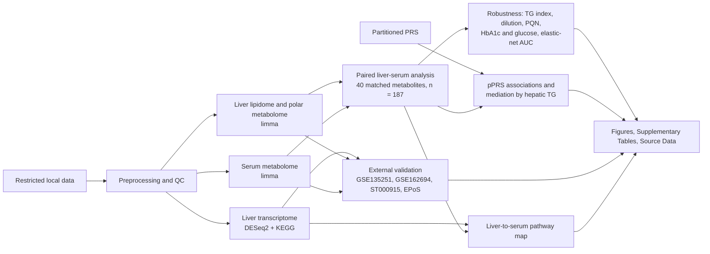

<p align="center">
  
</p>

<p align="center">
  <a href="https://www.r-project.org/"></a>
  <a href="LICENSE"></a>
  
  
  
</p>

<p align="center">
Code for <b>"Matched liver–serum multi-omics and genetic risk reveal hepatic compartmentalization of metabolic disease in severe obesity"</b> (Gupta et al.).<br/>
Liver transcriptome, lipidome and polar metabolome, serum metabolome and partitioned polygenic risk scores in 211 MAFALDA participants, with external validation in three public cohorts.
</p>

---

## Contents

[Main findings](#main-findings) · [Study design](#study-design) · [Workflow](#workflow) · [Repository structure](#repository-structure) · [Figure and table map](#figure-and-table-map) · [Running the code](#running-the-code) · [Source Data](#source-data) · [Data availability](#data-availability) · [Citation](#citation)

---

## Main findings

<p align="center">
  
</p>

1. **Circulating metabolites do not mirror the liver.** In 187 participants with matched samples, 40 metabolites measured in both compartments correlated weakly (median Spearman ρ = 0.02).
2. **Histology is a hepatic signal.** Steatosis and lobular inflammation were associated with 116 and 216 of 701 hepatic metabolites but ≤ 1 of 653 serum metabolites.
3. **Hepatic amino acids are lower with lobular inflammation without serum change**, independently of tissue fat, sample dilution and glycemia, although largely shared with steatosis.
4. **Serum adds little to clinical discrimination** (steatosis AUC 0.73 → 0.75; nothing for inflammation, MASH or fibrosis), whereas hepatic metabolites raise it to 0.91 for steatosis.
5. **A discordant partitioned PRS** (genetic hepatic lipid retention) is associated with higher hepatic but lower serum triglycerides; its effects on inflammation and MASH are largely mediated by liver fat.
6. **Transcriptomic and hepatic triglyceride signatures replicate externally** (GSE135251, GSE162694, ST000915); the phosphatidylcholine signature does not.

---

## Study design

<p align="center">
  
</p>

| Layer | Source | Participants | Used in |
|---|---|---:|---|
| Hepatic transcriptome (RNA-seq) | liver biopsy | 208 | Fig. 1, Fig. 3, Fig. 6 |
| Hepatic lipidome | liver biopsy | – | Table S3, Fig. 3, Fig. 6 |
| Hepatic polar metabolome | liver biopsy | 189 | Fig. 2, Table S4, Fig. 4, Fig. 6 |
| Serum polar metabolome | serum | 209 | Fig. 2, Table S10a |
| Matched liver–serum polar metabolome | liver + serum | 187 | Fig. 4, Tables S10b–S11 |
| Partitioned polygenic risk scores | genotype | 211 | Fig. 5, Table S12 |

---

## Workflow



---

## Repository structure

Every figure has its own folder with a self-contained R Markdown script and its tables and Source Data.

```text
masld-sex-stratified-multiomics/
├── README.md
├── LICENSE
├── common/
│   ├── setup.R                          # packages, paths, thresholds, helpers (sourced by every script)
│   └── README.md
├── Table1_cohort/                       # <folder>.Rmd + Source_data/
├── Fig1_hepatic_transcriptome/
├── Hepatic_lipidome/
├── Hepatic_polar_metabolome/
├── Fig2_serum_metabolome/
├── Fig3_external_validation/
├── Fig4_paired_liver_serum/
├── Fig5_pPRS/
├── Fig6_pathway_map/
├── Supp_EPoS_serum_validation/
├── Supp_methods_tables/                 # Tables S17-S18 only (no code)
├── Assemble_supplementary_tables/       # collects all tables into one workbook
├── data/                                # input files, not tracked (see data/README.md)
├── results/                             # created when the code runs, not tracked
└── assets/                              # README graphics
```

Each `<folder>/Source_data/` holds the Supplementary Tables used by that item (`Table_S*.csv`) and the Source Data workbook written by the code.

---

## Figure and table map

| Item | Content | Supplementary Tables | Folder |
|---|---|---|---|
| Table 1 | Cohort characteristics by sex | – | `Table1_cohort` |
| Fig. 1, Fig. S1 | Hepatic DEGs (steatosis, inflammation, fibrosis), overlap, KEGG | S1, S2a, S2b | `Fig1_hepatic_transcriptome` |
| – | Hepatic lipid signatures | S3 | `Hepatic_lipidome` |
| – | Hepatic polar metabolite signatures | S4 | `Hepatic_polar_metabolome` |
| Fig. 2 | Hepatic and serum polar metabolites | S4, S10a | `Fig2_serum_metabolome` |
| Fig. 3 | External validation: GSE162694, GSE135251, ST000915 | S5–S9 | `Fig3_external_validation` |
| Fig. 4 | Paired liver–serum comparison, robustness, AUC | S10b, S11 | `Fig4_paired_liver_serum` |
| Fig. 5 | Partitioned PRS, mediation by hepatic TG | S12 | `Fig5_pPRS` |
| Fig. 6 | Liver-to-serum pathway map | S1, S3, S4, S10a, S10b, S12 | `Fig6_pathway_map` |
| Supplementary | EPoS (ST001711) serum validation | S19, S20 | `Supp_EPoS_serum_validation` |
| Supplementary | LC-MS conditions, external datasets | S17, S18 | `Supp_methods_tables` |
| Supplementary | All tables in one workbook | S1–S12, S19–S20 | `Assemble_supplementary_tables` |

Tables used by more than one item are stored in each folder that uses them. Tables S13–S16 (network and mediation analyses) are not part of this repository.

---

## Running the code

1. Put the input files in `data/` (see `data/README.md`), or point to them:

```r
Sys.setenv(MASLD_DATA_DIR = "/path/to/folder/containing/Analyisis")   # only if not in ./data
```

2. Open any `<folder>/<folder>.Rmd` in RStudio and knit it (or `rmarkdown::render("Fig3_external_validation/Fig3_external_validation.Rmd")`). The repository root is found automatically.

The analyses build on each other (Fig. 1 DESeq2 results → Fig. 3; hepatic and serum limma → Fig. 4 → Figs 5–6). Each script ends by saving its workspace to `results/cache/` and starts by loading the previous step, or by running it first if needed. The order is:

`Table1_cohort` → `Fig1_hepatic_transcriptome` → `Hepatic_lipidome` → `Hepatic_polar_metabolome` → `Fig2_serum_metabolome` → `Fig3_external_validation` → `Fig4_paired_liver_serum` → `Fig5_pPRS` → `Fig6_pathway_map` → `Supp_EPoS_serum_validation` → `Assemble_supplementary_tables`

The first run of a later figure therefore also runs everything before it; later runs reuse the cache.

**Supplementary Tables workbook.** A few steps read the published tables (Table S3 curated lipid names, S11 AUCs, S12). The code uses, in order: the file in `MASLD_SUPP_XLSX`; a file named `gupta_MASLD_SupplementaryTables*.xlsx` in `data/` or the repository root; otherwise a workbook rebuilt from the `Table_S*.csv` files in the `Source_data/` folders.

Optional environment variables: `MASLD_DATA_DIR`, `MASLD_RESULTS_DIR`, `MASLD_SUPP_XLSX`.

Main packages: DESeq2, apeglm, limma, POMA, clusterProfiler, GEOquery, glmnet, pROC, mediation, openxlsx, readxl, ggplot2, dplyr. Generate `sessionInfo.txt` after the final run:

```r
writeLines(capture.output(sessionInfo()), "sessionInfo.txt")
```

---

## Source Data

Knitting a figure script writes its Nature-style Source Data workbook, one sheet per panel, into that figure's `Source_data/` folder:

| File | Folder | Content |
|---|---|---|
| `Source Data Fig. 1.xlsx` | `Fig1_hepatic_transcriptome/Source_data/` | volcano results, DEG overlap, KEGG |
| `Source Data Fig. S1.xlsx` | `Fig1_hepatic_transcriptome/Source_data/` | PCA |
| `Source Data Fig. 2.xlsx` | `Fig2_serum_metabolome/Source_data/` | Sankey and combined metabolite table |
| `Source Data Fig. 3.xlsx` | `Fig3_external_validation/Source_data/` | external replication panels a–d |
| `Source Data Fig. 4.xlsx` | `Fig4_paired_liver_serum/Source_data/` | paired liver–serum panels |
| `Source Data Fig. 5.xlsx` | `Fig5_pPRS/Source_data/` | pPRS associations and mediation |
| `Source Data Fig. 6.xlsx` | `Fig6_pathway_map/Source_data/` | pathway map |

Commit these files; they are summary-level. Your `.gitignore` must allow them (`!*/Source_data/*.xlsx`).

---

## Data availability

Individual-level data cannot be shared because the consent obtained does not cover public release. Summary-level results are in Supplementary Tables S1–S12 and S19–S20 (CSV copies in each folder's `Source_data/`). Public datasets: GEO GSE135251 and GSE162694; Metabolomics Workbench ST000915 and ST001711. Pooled quality-control data are deposited at MassIVE ([doi:10.25345/C50P0X49Q](https://doi.org/10.25345/C50P0X49Q)). Do not commit participant identifiers, clinical metadata, omics matrices or intermediate objects; `.gitignore` excludes `data/` and `results/`.

---

## Citation

```text
Gupta S, Jamialahmadi O, Mancina RM, Duberg D, Vespasiani-Gentilucci U, Tavaglione F, Bruni V,
Tuccinardi D, Hyötyläinen T, Romeo S, Orešič M. Matched liver–serum multi-omics and genetic risk
reveal hepatic compartmentalization of metabolic disease in severe obesity. (Manuscript.)
Code: https://github.com/shashank-KU/masld-sex-stratified-multiomics
```

Replace with the final reference and the Zenodo DOI after publication.

## License

MIT for code and documentation. No access to restricted participant-level data is granted.

## Author and contact

**Shashank Gupta**, Örebro University · [GitHub](https://github.com/shashank-KU). Questions about the workflow: open an issue (never include participant-level information).
